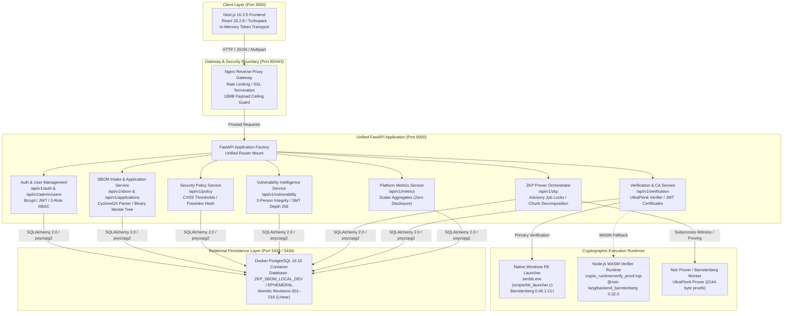
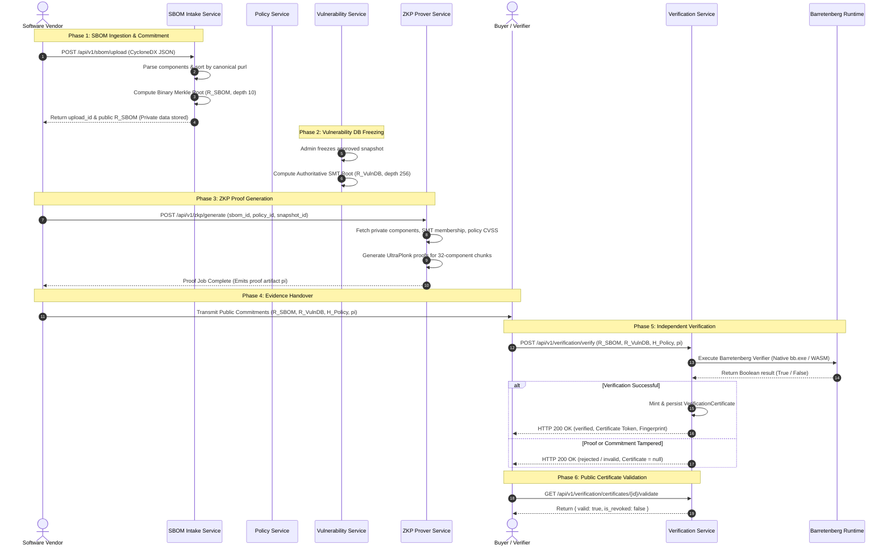
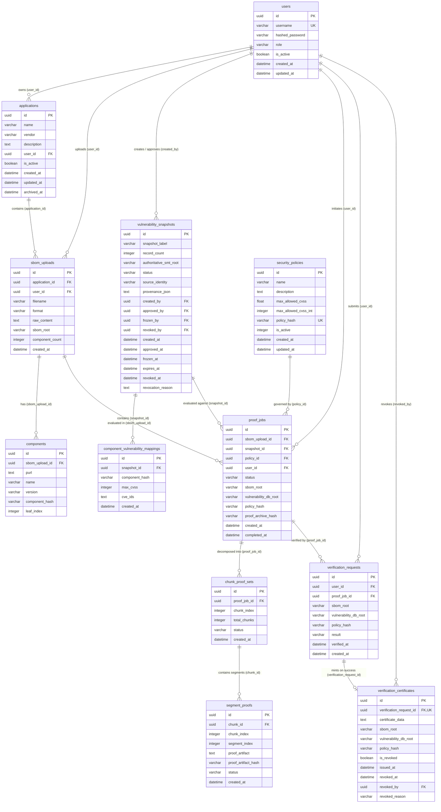

# System Architecture, Data Flow, Schema & Technical Reference

**Document Version:** 4.0.0-final-release-ready
**Workspace Root:** `E:\Main Project`
**Authoritative Location:** `project_context/ARCHITECTURE.md`
**Effective Date:** 30 October 2026
**Status:** Authoritative Technical Reference (Stage F3 Complete)

---

## 1. System Topology & Architecture Overview

The Zero-Knowledge Software Supply Chain Verification platform enables software vendors to cryptographically prove that a private Software Bill of Materials (SBOM) complies with customer security policies (e.g., maximum CVSS threshold $\le \text{Threshold}$) against an authoritative vulnerability database, without revealing proprietary package names, versions, or dependency topologies.

The system is organized into a modern decoupled architecture comprising a Next.js frontend, an Nginx reverse proxy gateway, a unified FastAPI backend coordinating six modular services, native/WASM cryptographic verifier runtimes, and an isolated PostgreSQL 16 database.

---

## 2. Microservice Boundaries & Component Responsibilities

### 2.1 Frontend Client (`frontend/`)
- **Technology:** Next.js 16.3.5 (App Router), React 19.2.8, Tailwind CSS, TypeScript 5.
- **Service Boundaries:** Communicates exclusively with the backend via `/api/v1/*` HTTP JSON and multipart endpoints.
- **In-Memory Security:** JWT bearer tokens are strictly managed in runtime memory via `authTransport.ts` closures. Tokens are cleared on logout, 401 response, or window reload. No tokens or secrets are ever persisted to `localStorage`, `sessionStorage`, or browser cookies.
- **Route Guarding:** Client-side role authorization is managed through `RouteGuard.tsx`, mapping the 3 consolidated roles (`admin`, `vendor`, `buyer`) to route access permissions.
- **Compiled Routes:** 19 total routes (17 statically prerendered, 2 server-rendered dynamic routes: `/certificates/[id]` and `/proofs/[id]`).

### 2.2 Shared Domain & Authentication Service (`backend/shared/`)
- **Password Security:** Enforces Argon2id/Bcrypt password hashing with strict length validation (minimum 8 characters, maximum 72 bytes). Enforces constant-time dummy verification on invalid usernames to eliminate user enumeration side-channels.
- **Authoritative 3-Role RBAC Model:** All new self-registered accounts are strictly assigned base role `buyer` (`auth_routes.py` line 97). Role escalations are restricted to administrators.
  1. `vendor`: Manages registered applications and private SBOM uploads; initiates asynchronous ZKP proving jobs.
  2. `buyer`: Inspects verification certificates, executes independent proof verification, and accesses public commitments (default self-registration role).
  3. `admin`: Manages user roles and activation states, activates global security policies, ingests vulnerability feeds under Two-Person Integrity, approves/freezes/revokes vulnerability snapshots, and revokes certificates.
  *Note: Legacy roles (`auditor` and `trusted_importer`) are retired from active assignment, registration, filters, and UI workflows. Historical database constraints and migrations 001–016 remain preserved.*
- **Concurrency & Admin Safety:** Role and status mutations are serialized using transaction-scoped PostgreSQL advisory locks (`pg_advisory_xact_lock` on key `6506399120658742601`). The system enforces strict last-admin protection, blocking the demotion or deactivation of the final active administrator.

### 2.3 SBOM & Application Management Service (`backend/sbom_service/`)
- **Standalone Application Lifecycle:** Manages vendor applications (`sbom.applications`) scoped by caller `user_id`. Supports metadata updates, idempotent soft-archiving (`is_active=False`, `archived_at` recorded), and reactivation.
- **Intake & Merkle Commitment:** Ingests CycloneDX SBOM JSON payloads (up to 10 MB limit enforced by middleware). Parses components, standardizes canonical package URLs (`purl`), deterministically sorts components, and computes a Poseidon binary Merkle tree root ($R_{\text{SBOM}}$, depth 10, capacity 1024 leaves).
- **Data Protection:** Persists raw component records in `sbom.components` with tenant scoping. Raw components, purls, versions, and dependency trees are strictly isolated and never returned to buyers, auditors, or external callers.

### 2.4 Security Policy Service (`backend/policy_service/`)
- **Compliance Rules:** Stores system-wide compliance policies (`policy.security_policies`) defining `max_allowed_cvss` (scaled integer $[0, 100]$ for circuit arithmetic).
- **Canonical Policy Hash:** Calculates Poseidon hash commitment $H_{\text{Policy}} = \text{Poseidon}([\text{max\_allowed\_cvss\_int}])$.
- **Single Active Policy Invariant:** Enforces that exactly one policy is active at any time. Activating a policy atomically deactivates all other policies within the same transaction.

### 2.5 Vulnerability Intelligence Service (`backend/vulnerability_service/`)
- **Two-Person Integrity:** Strict separation of duties between data ingestion and snapshot authorization:
  - Ingestion restricted to `trusted_importer` from verified trusted sources (`NVD`, `OSV`, `GitHub Advisory Database`). Created in status `pending`.
  - Approval and Freezing restricted to `admin`. The creator of a snapshot is explicitly prohibited from approving their own snapshot (`vulnerability_routes.py` line 162).
- **Sparse Merkle Tree Commitment:** Upon snapshot freezing, the service computes an authoritative Sparse Merkle Tree (SMT, depth 256) root ($R_{\text{VulnDB}}$) over all component hash leaves using Poseidon sponge hashing ($t=2$ leaf hash, $t=3$ branch nodes).
- **Snapshot Immutability:** Once `frozen`, snapshot mappings and SMT roots are strictly immutable. Only frozen snapshots can be referenced by proof-generation jobs.
- **Snapshot Freshness & Automated TTL (Alembic Rev 016):**
  - Implements the 7 locked decisions (D7-POL-01 through D7-POL-07).
  - Snapshot model includes nullable `expires_at` timestamp calculated upon freezing: `expires_at = frozen_at + timedelta(seconds=ttl_seconds)`.
  - Configured via environment variable `VULNERABILITY_SNAPSHOT_TTL_SECONDS`. Default TTL is 30 days (2,592,000 seconds), bounded between 3,600 seconds (1 hour) and 31,536,000 seconds (365 days). Invalid, zero, negative, or out-of-range configuration fails closed with `SnapshotTTLConfigurationError` (silent clamping is prohibited).
  - Existing legacy snapshots remain grandfathered as non-expired (`expires_at = NULL`) to preserve accepted baselines. No `expired` database lifecycle status exists.
  - Enforcement is strictly synchronous across three required checkpoints: proof-job creation (`zkp_repository.create_job`), immediately prior to proving (`prover_service.process_job`), and authoritative verification (`verification_repository.validate_authoritative_records`). The expiry boundary is `now_utc >= expires_at`.
  - Historical certificate validity is strictly preserved: expiration of a source snapshot does not retroactively invalidate previously issued compliance certificates.
  - No background scheduler or daemon dependency.

### 2.6 ZKP Prover Service (`backend/zkp_service/`)
- **Job Orchestration:** Asynchronously orchestrates proof generation for vendor-owned applications. Binds four commitments: `application_id`, `sbom_id`, `policy_id`, and a `frozen` `snapshot_id`.
- **Worker Concurrency & Advisory Locks:** Employs database worker locks to prevent duplicate concurrent proving runs per user (HTTP 429 response on collision). Integrates automatic stale/abandoned job reconciliation on poller recovery.
- **Circuit Decomposition:** Decomposes proof workloads into 32-component chunks across 8 sequential segments per chunk, linked by intermediate state hashes.
- **Live Acceptance Execution & Standalone Artifact Accounting:** In the live 256-segment acceptance probe, Segment 0 proof generation and verification executed in-flight within temporary execution storage (2,144-byte raw proof body; 2,304-byte serialized proof with public inputs). The runner persisted base64 records into in-memory SQLite and cleaned temporary storage; no durable standalone binary proof file (`chunk_0_segment_0_proof.bin`) was written to disk. The full 256-segment workload remains classified as `BLOCKED` because 254 segments remain unattempted.
- **Runtime Resource Watchdog Safeguards:**
  - Active runtime monitoring enforces a mandatory host memory safety floor (`min_host_ram_gib = 2.0 GiB`).
  - If guest proving processes (in WSL or host) trigger a memory surge causing Windows host available RAM to drop below 2.0 GiB, the watchdog intercepts execution within 1.0 second.
  - Dispatches targeted `SIGTERM` directly to the specific guest prover PID (e.g., PID 757), cleanly releasing all memory allocations and preventing workstation crashes or OS lockups.

### 2.7 Verification Service & Certificate Authority (`backend/verification_service/`)
- **Zero-Knowledge Verification:** Public verifier endpoint (`/api/v1/verification/verify`). Operates strictly on public commitments ($R_{\text{SBOM}}$, $R_{\text{VulnDB}}$, $H_{\text{Policy}}$, and proof artifact $\pi$). Never touches, requests, or processes private SBOM components.
- **Dual Cryptographic Runtime Execution:**
  - *Primary Runtime:* Native Windows PE verifier launcher (`.bin/bb.exe` compiled from `scripts/bb_launcher.c`) invoking Barretenberg 0.46.1.
  - *Fallback Runtime:* Isolated Node.js WASM Barretenberg runtime (`backend/verification_service/crypto_runtime/verify_proof.mjs`).
- **Fail-Closed Gate:** An explicit Boolean `true` from Barretenberg is strictly required to issue a certificate. Mismatched public inputs, malformed proof bodies (non-2144 bytes), or verifier crashes fail closed.
- **Certificate Authority & Online Revocation:** Mints cryptographically signed, timestamped certificates (`verification.verification_certificates`) containing unique SHA-256 fingerprints. Exposes unauthenticated, real-time public validation endpoints (`/certificates/{id}/validate` and `/certificates/validate-token`) that enforce instantaneous revocation checks.

---

## 3. End-to-End Cryptographic Data Flow

The following sequence illustrates the end-to-end lifecycle from SBOM submission to independent buyer verification:

### 3.1 Data Classification & Privacy Matrix

To guarantee mathematical confidentiality and compliance with privacy objectives, data is strictly classified into five tiers across its lifecycle:

| Data Element | Storage Location | Transmission Boundary | Verifier Visibility | Privacy Invariant |
| :--- | :--- | :--- | :--- | :--- |
| **Raw SBOM Content & Purls** | `sbom.sbom_uploads.raw_content`, `sbom.components.purl` | Vendor $\rightarrow$ SBOM Intake API | **NEVER DISCLOSED** | Zero-Knowledge Protected. Isolated in vendor tenant schema. |
| **Component Dependency Graph** | In-memory during parsing | None (internal to service) | **NEVER DISCLOSED** | Discarded after Merkle tree generation. |
| **SBOM Merkle Root ($R_{\text{SBOM}}$)** | `sbom.sbom_uploads.sbom_root` | Vendor $\rightarrow$ Prover $\rightarrow$ Verifier | **PUBLICLY DISCLOSED** | 32-byte Poseidon root commitment. Reveals zero component details. |
| **Raw CVE Feed Data** | `vulnerability.vulnerability_records` | Importer $\rightarrow$ Vuln Service | **NEVER DISCLOSED TO BUYER** | Internal vulnerability catalog. |
| **Authoritative SMT Root ($R_{\text{VulnDB}}$)** | `vulnerability_snapshots.authoritative_smt_root` | Vuln Service $\rightarrow$ Verifier | **PUBLICLY DISCLOSED** | 32-byte SMT root commitment over all vulnerability mappings. |
| **Policy CVSS Threshold & Hash ($H_{\text{Policy}}$)** | `policy.security_policies.policy_hash` | Policy Service $\rightarrow$ Verifier | **PUBLICLY DISCLOSED** | 32-byte Poseidon hash over maximum allowed CVSS score. |
| **UltraPlonk Proof Artifact ($\pi$)** | `zkp.segment_proofs.proof_artifact` | Prover $\rightarrow$ Vendor $\rightarrow$ Verifier | **PUBLICLY DISCLOSED** | 2144-byte cryptographic SNARK proof. Zero secret leakage. |
| **Signed Verification Certificate** | `verification.verification_certificates` | Verifier $\rightarrow$ Buyer $\rightarrow$ Public | **PUBLICLY DISCLOSED** | Cryptographically signed token asserting proof validity. |

---

## 4. Cryptographic Specifications & Invariants

| Parameter | Specification | Cryptographic Invariant |
| :--- | :--- | :--- |
| **Elliptic Curve** | BN254 (alt_bn128) | Field modulus $r = 21888242871839275222246405745257275088548364400416034343698204186575808495617$ |
| **Scalar Encoding** | Canonical Big-Endian (32 bytes) | Strict validation: `0x`-prefixed 64 hexadecimal characters, $0 \le x < r$. |
| **Hash Function** | Poseidon Sponge Permutation | $t=2$ for leaf commitments; $t=3$ for 2-to-1 binary Merkle tree node evaluation. |
| **SBOM Merkle Tree** | Binary Merkle Tree (Depth 10) | Maximum capacity: $2^{10} = 1024$ component leaves. Unpopulated leaves padded with zeros. |
| **Vulnerability DB SMT** | Sparse Merkle Tree (Depth 256) | Keyed by 256-bit component hash. Empty subtrees dynamically precomputed per tree instance. |
| **Circuit Chunks** | 32 Components per Segment | 1024-component capacity evaluated in 32-component chunks linked by intermediate state hashes. |
| **Proof Format & Size** | UltraPlonk Proof (2144 bytes) | Exactly 2144 bytes body size per Noir 0.32.0 / Barretenberg 0.46.1 ACIR specification. |
| **Verifier Invariant** | Strict Boolean Equality | The verifier requires explicit `true` return. Swallowed exceptions or unhandled returns fail closed. |

### 4.1 Segment Public Input Ordering
To prevent input permutation or commitment swapping attacks, public inputs are strictly bound in canonical order:
1. **`segment_init_32`** (5 public inputs / 2304 bytes total proof):
   `[global_sbom_root, policy_hash, chunk_index, components_commit, hash_out_commit]`
2. **`segment_mid_32`** (4 public inputs / 2272 bytes total proof):
   `[segment_index, components_commit, hash_in_commit, hash_out_commit]`
3. **`segment_final_32`** (3 public inputs / 2240 bytes total proof):
   `[vulnerability_db_root, components_commit, hash_in_commit]`

---

## 5. Entity-Relationship Data Model & Schema Catalog

The relational schema is partitioned across six logical PostgreSQL schemas: `public`, `sbom`, `vulnerability`, `policy`, `zkp`, and `verification`.

### 5.1 Enforced Database Constraints Catalog
- **`chk_users_role`** (`public.users`): Enforces allowed roles `IN ('vendor', 'buyer', 'auditor', 'admin', 'trusted_importer')`.
- **`uq_sbom_applications_name_vendor_user`** (`sbom.applications`): Enforces unique composite key `(name, vendor, user_id)` (Migration 014).
- **`chk_sbom_applications_archival`** (`sbom.applications`): Enforces `(is_active = true AND archived_at IS NULL) OR (is_active = false AND archived_at IS NOT NULL)` (Migration 015).
- **`uq_vuln_mapping_snapshot_comp`** (`vulnerability.component_vulnerability_mappings`): Enforces uniqueness on `(snapshot_id, component_hash)`.
- **`uq_chunk_index_per_job`** (`zkp.chunk_proof_sets`): Enforces unique chunk indexes within a proving job.
- **`chk_chunk_index_bounds`** (`zkp.chunk_proof_sets`): Enforces $0 \le \text{chunk\_index} < 32$.
- **`uq_segment_index_per_chunk`** (`zkp.segment_proofs`): Enforces unique segment indexes within a chunk proof set.
- **`chk_segment_index_bounds`** (`zkp.segment_proofs`): Enforces $0 \le \text{segment\_index} < 8$.
- **`uq_verification_request_idempotency`** (`verification.verification_requests`): Enforces uniqueness on `(user_id, sbom_root, vulnerability_db_root, policy_hash, proof_job_id)`.
- **`uq_cert_per_request`** (`verification.verification_certificates`): Enforces 1-to-1 relationship between a verification request and certificate.
- **`chk_certificate_revocation_state`** (`verification.verification_certificates`): Enforces `(is_revoked = false AND revoked_at IS NULL AND revoked_by IS NULL) OR (is_revoked = true AND revoked_at IS NOT NULL)` (Migration 015).

---

## 6. Comprehensive Service API Reference

### 6.1 Authentication & Session API (`/api/v1/auth`)
| Method & Route | Access Gate | Request Payload / Params | Response Codes | Description & Invariants |
| :--- | :--- | :--- | :--- | :--- |
| `POST /login` | Public | Form: `username`, `password` | 200, 401, 403 | Issues JWT Bearer token. Constant-time dummy verification on unknown user. Rejects deactivated accounts (403). |
| `POST /register` | Public | Form: `username`, `password` | 201, 400, 422 | Self-registration. Assigns base role `buyer`. Password $\ge 8$ chars, $\le 72$ bytes. Hash never returned. |
| `GET /me` | Authenticated | None (Bearer Token) | 200, 401 | Returns caller identity (`id`, `username`, `role`, `is_active`, timestamps). Never discloses password hash. |
| `POST /change-password` | Authenticated | JSON: `current_password`, `new_password` | 200, 400, 422 | Self-service password change. Enforces password boundary constraints. |

### 6.2 Administrative User Management API (`/api/v1/admin/users`)
| Method & Route | Access Gate | Request Payload / Params | Response Codes | Description & Invariants |
| :--- | :--- | :--- | :--- | :--- |
| `GET ""` | `admin` | Query: `skip`, `limit`, `role`, `is_active` | 200, 403, 422 | Lists registered users with pagination and filtering. |
| `GET "/{user_id}"` | `admin` | Path: `user_id` (UUID) | 200, 403, 404 | Retrieves single user details. Non-disclosing 404 if absent. |
| `PATCH "/{user_id}/role"` | `admin` | JSON: `role` (3-role model: vendor, buyer, admin) | 200, 400, 403, 409, 422 | Updates user role. Serialized by PostgreSQL advisory lock. Rejects demotion of the last active administrator (400). |
| `PATCH "/{user_id}/status"`| `admin` | JSON: `is_active` (bool) | 200, 400, 403, 404 | Updates account status. Blocks self-deactivation and deactivation of the last active administrator. |

### 6.3 Standalone Application API (`/api/v1/applications`)
| Method & Route | Access Gate | Request Payload / Params | Response Codes | Description & Invariants |
| :--- | :--- | :--- | :--- | :--- |
| `POST ""` | `vendor`, `admin` | JSON: `name`, `vendor`, `description` | 201, 400, 403, 422 | Creates an application owned by caller. Enforces `(name, vendor, user_id)` uniqueness. |
| `GET ""` | Authenticated | Query: `skip`, `limit`, `include_archived` | 200, 401 | Lists owned applications. Excludes soft-archived applications by default. |
| `GET "/{app_id}"` | Authenticated | Path: `app_id` (UUID) | 200, 401, 404 | Retrieves application details. Returns non-disclosing 404 on cross-tenant lookup. |
| `PATCH "/{app_id}"` | `vendor`, `admin` | JSON: `name`, `description` | 200, 400, 403, 404 | Updates permitted metadata on active owned application. |
| `POST "/{app_id}/archive"`| `vendor`, `admin` | Path: `app_id` (UUID) | 200, 403, 404 | Soft-archives application. Idempotent. Blocks future SBOM uploads while preserving historical records. |
| `POST "/{app_id}/reactivate"`| `vendor`, `admin` | Path: `app_id` (UUID) | 200, 403, 404 | Reactivates soft-archived application. Idempotent. |

### 6.4 SBOM Intake API (`/api/v1/sbom`)
| Method & Route | Access Gate | Request Payload / Params | Response Codes | Description & Invariants |
| :--- | :--- | :--- | :--- | :--- |
| `POST "/upload"` | `vendor`, `admin` | JSON or Multipart: `application_name`, `vendor`, `content`, `format` | 201, 400, 403, 415, 422 | Ingests CycloneDX SBOM. 10MB limit. Computes Binary Merkle Tree ($R_{\text{SBOM}}$). Raw content never returned. |
| `GET ""` | Authenticated | Query: `skip`, `limit`, `all_tenants` | 200, 401, 403 | Lists uploads scoped to caller `user_id`. `all_tenants=True` restricted to `admin` (403 otherwise). |
| `GET "/{upload_id}"` | Authenticated | Path: `upload_id` (UUID) | 200, 401, 404 | Returns upload metadata and $R_{\text{SBOM}}$. Returns non-disclosing 404 on cross-tenant lookup. |

### 6.5 Security Policy API (`/api/v1/policy`)
| Method & Route | Access Gate | Request Payload / Params | Response Codes | Description & Invariants |
| :--- | :--- | :--- | :--- | :--- |
| `GET ""` | Authenticated | Query: `skip`, `limit` | 200, 401 | Lists compliance policies ordered by creation date. |
| `GET "/{policy_id}"` | Authenticated | Path: `policy_id` (UUID) | 200, 401, 404 | Retrieves single policy details and canonical Poseidon policy hash. |
| `POST ""` | `admin` | JSON: `max_cvss_score`, `name`, `description` | 200, 403, 422 | Creates security policy and computes canonical Poseidon hash commitment. |
| `POST "/{policy_id}/activate"`| `admin` | Path: `policy_id` (UUID) | 200, 403, 404 | Atomically activates specified policy, deactivating all others in the transaction. |

### 6.6 Vulnerability Intelligence API (`/api/v1/vulnerability`)
| Method & Route | Access Gate | Request Payload / Params | Response Codes | Description & Invariants |
| :--- | :--- | :--- | :--- | :--- |
| `POST "/ingest"` | `trusted_importer` | JSON: `source_identity`, `vulnerabilities` | 200, 403, 422 | Ingests raw CVE feeds from trusted sources (`NVD`, `OSV`, `GitHub`). Creates snapshot in `pending` status. |
| `GET "/snapshots"` | Authenticated | Query: `skip`, `limit`, `status` | 200, 401, 403, 422 | Lists snapshots. Non-admins only see `approved` and `frozen` catalog records. |
| `GET "/snapshots/{id}"` | Authenticated | Path: `snapshot_id` (UUID) | 200, 401, 404 | Retrieves snapshot details. Non-admins receive 404 on pending/revoked records. |
| `POST "/snapshots/{id}/approve"`| `admin` | Path: `snapshot_id` (UUID) | 200, 400, 403, 404 | Approves snapshot. Enforces two-person integrity (creator cannot approve own snapshot). |
| `POST "/snapshots/{id}/freeze"` | `admin` | Path: `snapshot_id` (UUID) | 200, 400, 403, 404 | Computes authoritative SMT root ($R_{\text{VulnDB}}$) and transitions status to immutable `frozen`. |
| `POST "/snapshots/{id}/revoke"` | `admin` | Path: `snapshot_id`, JSON: `reason` | 200, 400, 403, 404 | Revokes snapshot. Revoked snapshots cannot be approved or frozen. |

### 6.7 ZKP Prover API (`/api/v1/zkp`)
| Method & Route | Access Gate | Request Payload / Params | Response Codes | Description & Invariants |
| :--- | :--- | :--- | :--- | :--- |
| `POST "/generate"` | `vendor`, `admin` | JSON: `sbom_id`, `policy_id`, `snapshot_id` | 202, 400, 403, 422, 429 | Initiates asynchronous proof job. Rejects concurrent jobs for same user (429). Requires `frozen` snapshot. |
| `GET ""` | Authenticated | Query: `skip`, `limit`, `all_tenants` | 200, 401, 403 | Lists proof jobs scoped to caller. `all_tenants=True` restricted to `admin`. |
| `GET "/jobs/{job_id}"` | Authenticated | Path: `job_id` (UUID) | 200, 401, 404 | Retrieves job progress and public proof artifacts. Includes automatic abandoned-worker reconciliation. |

### 6.8 Independent Verification & Certificate API (`/api/v1/verification`)
| Method & Route | Access Gate | Request Payload / Params | Response Codes | Description & Invariants |
| :--- | :--- | :--- | :--- | :--- |
| `POST "/verify"` | Authenticated | JSON or Multipart: `sbom_root`, `vulnerability_db_root`, `policy_hash`, `proof_artifact` | 200, 401, 415, 422 | Executes UltraPlonk verification via Barretenberg. On explicit `true`, automatically mints signed certificate. |
| `GET "/certificates"` | Authenticated | Query: `skip`, `limit` | 200, 401 | Lists certificates issued to the caller. |
| `GET "/certificates/{id}"` | Authenticated | Path: `certificate_id` (UUID) | 200, 401, 404 | Retrieves certificate details and SHA-256 fingerprint. Enforces tenant ownership checks. |
| `POST "/certificates/{id}/revoke"`| Authenticated | Path: `certificate_id`, JSON: `reason` | 200, 401, 403, 404 | Revokes certificate. Restricted to owner or `admin`. Records revoking actor attribution. |
| `GET "/certificates/{id}/validate"`| **Public** | Path: `certificate_id` (UUID) | 200 | Authoritative validity endpoint. Unguessable UUIDv4. Revoked certificates immediately return `valid: false`. |
| `POST "/certificates/validate-token"`| **Public** | JSON: `token` (JWT string) | 200 | Cryptographically verifies token signature and checks online revocation state. |

### 6.9 Platform Metrics API (`/api/v1/metrics`)
| Method & Route | Access Gate | Request Payload / Params | Response Codes | Description & Invariants |
| :--- | :--- | :--- | :--- | :--- |
| `GET ""` | Authenticated | None (Bearer Token) | 200, 401 | Returns caller-scoped aggregate counts: `total_sboms`, `total_jobs`, `total_certificates`, `total_verifications`. Zero disclosure of private component data. |

---

## 7. Database Migration History & Catalog (Revisions 001–015)

The database schema is strictly managed via a linear Alembic migration chain. All 15 migrations have been executed and verified against PostgreSQL 16 on port 5433:

| Rev ID | Migration File Name | Down Rev | Key Schema & Constraint Changes | Upgrade Assumptions & Notes |
| :---: | :--- | :---: | :--- | :--- |
| **`001_initial`** | `001_initial_schema.py` | `None` | Creates 5 logical schemas (`sbom`, `vulnerability`, `policy`, `zkp`, `verification`) and 11 foundational tables. | Baseline creation. Idempotent schema declarations. |
| **`002`** | `002_add_rbac_ownership_columns.py` | `001_initial` | Adds `user_id` / `created_by` columns to tables and establishes inter-schema foreign keys to `public.users(id)`. | Enforces tenant data isolation at database layer. |
| **`003`** | `003_add_chunk_proof_models.py` | `002` | Adds `zkp.chunk_proof_sets` and `zkp.segment_proofs` with integer segment indices. | Supports 32-component circuit decomposition. |
| **`004`** | `004_update_verification_model.py` | `003` | Expands `verification_requests` with proof bindings and verification timestamps. | Adapts schema for standalone proof verification. |
| **`005`** | `005_add_topology_constraints.py` | `004` | Adds check constraints for chunk and segment bounds: `chk_chunk_index_bounds` ($[0, 31]$), `chk_segment_index_bounds` ($[0, 7]$). | Enforces circuit capacity limits at DB level. |
| **`006`** | `006_add_proof_archive_hash.py` | `005` | Adds `proof_archive_hash` column to `zkp.proof_jobs` and `segment_proofs`. | Binds proof archives to cryptographic digests. |
| **`007`** | `007_enforce_proof_size.py` | `006` | Enforces proof body size restrictions (2144 bytes UltraPlonk format). | Aligns DB storage with official Barretenberg proof size. |
| **`008`** | `008_verification_idempotency_result_width.py` | `007` | Expands `result` column to 50 chars; adds composite unique constraint `uq_verification_request_idempotency`. | Prevents duplicate verification requests for identical tuples. |
| **`009`** | `009_certificate_revocation.py` | `008` | Adds `is_revoked`, `revoked_at`, and `revocation_reason` to `verification_certificates`. | Enables authoritative certificate revocation. |
| **`010`** | `010_allow_unavailable_without_proof_job.py` | `009` | Alters `proof_job_id` foreign key on `verification_requests` to allow `NULL` with `ON DELETE CASCADE`. | Allows direct proof verification without owned proof jobs. |
| **`011`** | `011_schema_parity.py` | `010` | Restores missing ORM-declared foreign key cascades, unique constraints, and indexes across PostgreSQL. | Resolves historical PostgreSQL vs SQLite ORM divergence. |
| **`012`** | `012_vulnerability_ingestion_provenance.py` | `011` | Adds `source_identity`, `provenance_json`, and `ingested_at` to `vulnerability_snapshots`. | Preserves raw CVE feed ingestion provenance. |
| **`013`** | `013_add_vuln_lifecycle.py` | `012` | Adds lifecycle columns to `vulnerability_snapshots`: `status` (`pending`, `approved`, `frozen`, `revoked`), `authoritative_smt_root`, approval/freeze/revoke actor IDs and timestamps. | Implements 2-person integrity and SMT root persistence. |
| **`014`** | `014_application_tenant_isolation.py` | `013` | Enforces unique constraint `uq_sbom_applications_name_vendor_user` on `(name, vendor, user_id)` in `sbom.applications`. | Hardens multi-tenant application isolation (`AUD-A-001`). |
| **`015`** | `015_auth_lifecycle_and_revocation.py` | `014` | Adds `chk_users_role`, `is_active`, `updated_at` to `users`; adds application soft-archiving columns and `chk_sbom_applications_archival` constraint; adds `revoked_by` to certificates with `chk_certificate_revocation_state`. | Fully harmonizes Stage D authentication, archival, and revocation state. |

---

## 8. Architectural Invariants, Threat Model & Preserved Limitations

### 8.1 Core Security & Cryptographic Invariants
1. **Privacy-Preserving Verification:** A software vendor proves policy compliance without ever disclosing component names, versions, or package hierarchies. The verification service operates strictly on public commitments.
2. **Fail-Closed Verification Policy:** Only an explicit Boolean `true` returned by the Barretenberg verifier allows a certificate to be issued. Mismatches, truncated proofs, or verifier crashes fail closed.
3. **Multi-Tenant Data Isolation:** Application entities, SBOM records, proving jobs, and certificates are strictly partitioned by caller `user_id`. Cross-tenant lookups and mutations return non-disclosing HTTP 404 responses.
4. **Separation of Duties (2-Person Integrity):** Vulnerability ingestion is restricted to `trusted_importer`. Snapshot approval and freezing are restricted to `admin`. An admin is strictly prohibited from approving a snapshot they created.
5. **Authoritative Revocation Guarantee:** A revoked certificate or vulnerability snapshot is immediately and irrevocably invalid. Validation endpoints query live database state and fail closed on revoked tokens.

### 8.2 Locked Stage D Disclosed Limitations Register
In accordance with formal project owner decisions recorded on 22 October 2026, three known limitations are acknowledged and preserved:
1. **Full 256-Segment Proving Workload (`PASS (BOUNDED) / UNVERIFIED (FULL 256-SEGMENT)`):** Live proving is verified for 1 segment (Segment 0 in 83.25 s) and resource containment is verified (watchdog cleanly terminated Segment 1 when host RAM breached the 2.0 GiB floor at 1.54 GiB). Full 256-segment proving remains unattempted on this hardware and is formally classified as `UNVERIFIED`.
2. **Live D9 Acceptance Step 5 (`RECOMMENDED CONDITIONAL ACCEPTANCE`):** During live intake testing against shared PostgreSQL 16 on port 5433, Step 5 (`POST /api/v1/policy`) was safely skipped by the test harness to preserve the shared baseline policy activation state (8/9 checks passed). Live policy creation was separately verified via a dedicated isolated container on port 5434 (14/14 checks passed, confirming admin RBAC, Poseidon hash equivalence, single-active-policy invariant, and transactional advisory locking).
3. **Automated Vulnerability Snapshot TTL (`RECOMMENDED CONDITIONAL ACCEPTANCE`):** Implemented in source under seven locked architectural decisions (D7-POL-01..07) with 30-day default TTL (range 1h–365d) anchored to freeze timestamps and evaluated synchronously across 3 service checkpoints. Verified across 37 deterministic matrix tests and live isolated migration 016 on port 5434. The local development database on port 5433 remains at revision 015 pending authorized execution of `run_pg16_migration_016.py`, and inclusion of migration 016 in `dist/zkp-sbom-source.zip` remains an open scope decision.

### 2.8 Vulnerability Intelligence Pipeline & Adapters (`backend/vulnerability_service/`)

- **Upstream Feed Adapters**:

  - `OSVAdapter`: Connects live to Google OSV API (`https://api.osv.dev/v1/query`) for npm advisories.

  - `NVDAdapter`: Connects live to NIST NVD 2.0 API (`https://services.nvd.nist.gov/rest/json/cves/2.0`) for CVE records.

  - Fail-closed upstream error handling: rate limits, timeouts, and malformed responses abort ingestion without mutating existing frozen snapshots.

- **Package Normalization & Ecosystem Matching**:

  - `NormalizationService`: Normalizes npm package names (including `@scope/name` scoped packages) and PyPI package names (PEP 503 lowercase and delimiter collapsing).

  - `EcosystemVulnerabilityMatcher`: Executes deterministic version matching using `semver` (npm) and `packaging.version` (PEP 440 for PyPI). Evaluates `introduced`, `fixed`, `last_affected`, and `unknown` bounds.

  - Unscannable handling: Components missing versions or declaring unsupported ecosystems (`cargo`, `golang`, `maven`) are flagged as `UNSCANNABLE` / `UNSUPPORTED_ECOSYSTEM`, causing evaluation to fail closed.

- **Snapshot Governance & Provenance**:

  - `SnapshotValidator`: Enforces that every snapshot has valid, parseable JSON provenance declaring `ecosystems_covered`.

  - Re-verifies that stored `authoritative_smt_root` mathematically matches the Sparse Merkle Tree root over all stored mappings.

  - Enforces Two-Person Integrity (`creator != approver != freezer`).

### 2.9 Security Policy Contract & Dual Digest Architecture (`backend/policy_service/`)

- **Canonical Policy Contract (`PolicyContract`)**:

  - Encapsulates policy parameters: `policy_id`, `revision`, `name`, `max_allowed_cvss`, `severity_limits`, `excluded_packages`.

- **Dual Commitment Architecture**:

  - *V1 Circuit Hash ($H_{\text{Policy}}$)*: Poseidon hash over `max_allowed_cvss_int` ($t=2$ sponge). Constrained inside frozen Noir circuit `segment_init_32`.

  - *V2 Contract Digest (`policy_digest_v2`)*: Domain-separated SHA-256 hash over canonical JSON contract string (`"ZK_SBOM_POLICY_V2:..."`). Bound inside issued certificate JWT payload.

- **Single Active Policy Invariant**:

  - Activating a policy revision atomically deactivates all other policies in a single database transaction.

### 2.10 Verification Share Subsystem (`backend/verification_service/`)

- **Proof Sharing Lifecycle (`verification.proof_shares`)**:

  - Solves separation of duties: Vendors own proof jobs and generate authorized reference tokens (`share_token`) for procurement buyers.

  - **Single Active Token Invariant**: Each completed proof job has at most one active share token at a time. Generating a new token automatically revokes previous tokens for that job.

  - **Lifecycle Deletion Rules**: Revoked tokens can be deleted individually; active tokens cannot be deleted. Deleting a share preserves proof jobs, requests, and certificates.

  - **Buyer Verification**: Buyers verify proof artifacts using the active share token without accessing vendor private data.

### 2.11 Verification Gateway Hardening & Concurrency Protection

- **Exact Snapshot Resolution**: Resolves snapshots using exact `ProofJob.snapshot_id` and verifies that the snapshot's authoritative SMT root strictly matches public input $R_{\text{VulnDB}}$ (`AUD-3A-005`).

- **Ecosystem Suitability Check**: Compares target SBOM ecosystems against snapshot declared coverage; rejects cross-ecosystem proofs fail-closed with `BLOCKED_INSUFFICIENT_COVERAGE` (`AUD-3A-006`).

- **TOCTOU Pre-Signing Re-Validation**: Re-queries `ProofJob`, `VulnerabilitySnapshot`, and `SecurityPolicy` within the active transaction immediately prior to certificate signing and persistence. Snapshot revocation, expiration, or policy deactivation aborts issuance fail-closed (`result = "record_mismatch"`).

- **Atomic Rollback**: Database write errors during certificate minting cleanly roll back the transaction, leaving zero invalid or orphaned certificates.

---

## 4. Cryptographic Enforcement Boundaries Matrix

| Security Property | Enforcement Boundary | Implementation Mechanism |

| :--- | :--- | :--- |

| SMT Membership & Non-Membership | **CIRCUIT-ENFORCED** | Poseidon sponge ($t=2, t=3$) 256-level traversal in `segment_final_32` against $R_{\text{VulnDB}}$. |

| Merkle Tree Inclusion (1024 slots) | **CIRCUIT-ENFORCED** | 10-level binary Merkle verification in `segment_init_32` against $R_{\text{SBOM}}$. |

| CVSS Policy Threshold ($H_{\text{Policy}}$) | **CIRCUIT-ENFORCED** | In-circuit constraint `assert(scores[i] <= policy_max_cvss)` in `segment_init_32`. |

| Cross-Ecosystem Protection | **BACKEND-ENFORCED** | `SnapshotValidator.validate_snapshot_suitability_for_sbom` compares SBOM ecosystems against snapshot provenance. |

| V2 Policy Contract Digest | **BACKEND-ENFORCED** & **CERTIFICATE-RECORDED** | `policy_digest_v2` and `policy_revision` bound in signed certificate JWT payload. |

| Snapshot Freshness & Expiry | **BACKEND-ENFORCED** | Synchronous TTL validation `now_utc >= expires_at` at proving and verification preflight. |

| Snapshot Revocation | **BACKEND-ENFORCED** | TOCTOU check `snapshot.revoked_at IS NOT NULL` before certificate signing. |

| Certificate Authenticity | **BACKEND-ENFORCED** | HS256 JWT signature using configured authority secret (`CERTIFICATE_SECRET_KEY`). |

| Public Non-Repudiation | **NOT ENFORCED** | HS256 is a symmetric MAC; verifiers must hold the authority secret. Asymmetric digital signatures deferred. |
